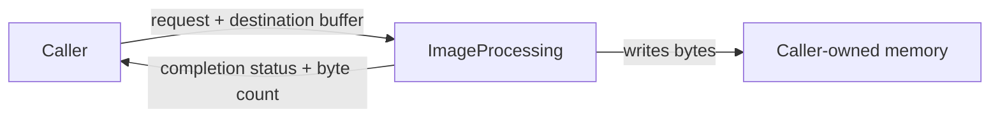
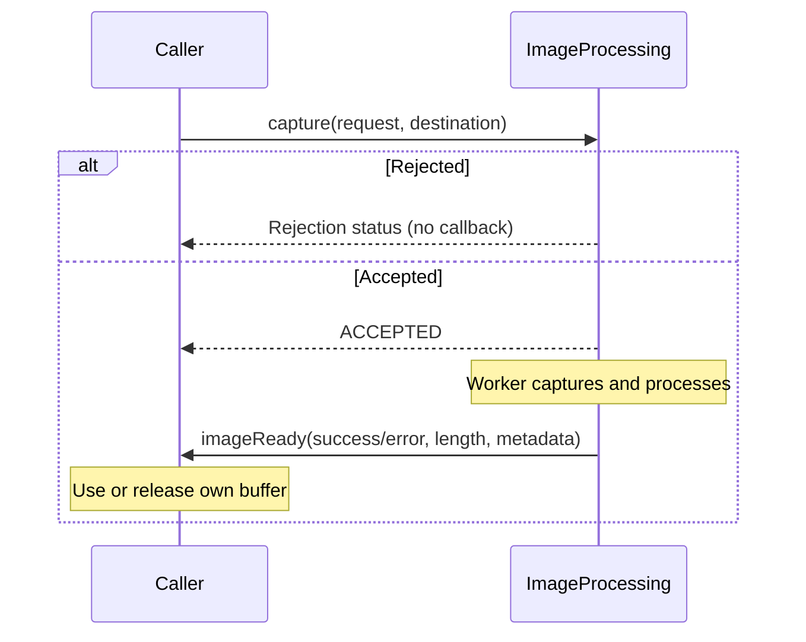

# Components::ImageProcessing

Processes image bytes in caller-owned memory. The caller chooses the encoding and handles storage/reconstruction.

## Usage Examples

- Payload: JPEG previews for image selection; lossless bytes for downlink.
- Star Tracker: original bytes without lossy re-encoding.
- PNG conversion and filesystem saving belong to the consumer.

### Diagrams

### Typical Usage

1. Caller submits its buffer address/capacity, camera ID, request ID and encoding.
2. Admission accepts/rejects immediately; accepted work uses one worker thread.
3. Caller keeps accepted buffers valid and untouched until completion.
4. Completion reports ID, status, encoding, length and frame layout. Caller then uses/reuses/releases memory.

## Class Diagram

`ImageProcessing` uses `FrameProcessor` for byte operations and `CameraSource` for capture/release. Both are internal C++ helpers; neither adds F´ ports.

## Port Descriptions

| Port Data Type | Name | Direction | Kind | Usage |
|---|---|---|---|---|
| ImageCapture | capture[2] | input | synchronous | Validate and queue; return admission status |
| ImageReady | imageReady[2] | output | receiver-defined | Completion metadata only; bytes remain in caller memory |
| Internal trigger | run | internal | asynchronous | Dispatch queued work on the component worker |

Two application port arrays are paired by caller index (payload/proxy and Star Tracker). `run` is private. Standard F´ event/telemetry/time ports are separate; no camera, scheduler, allocation, buffer-return or status-query ports.

## Component States

| Name | Description / entry cause |
|---|---|
| IDLE | Configured, or previous request/callback finished; no active request |
| CAPTURING | Worker starts a queued request and obtains its camera frame |
| PROCESSING | Frame acquired; validate/copy or encode bytes and report completion |
| FAULT | Camera reports `FAULT`, or frame release fails; further capture stops |

Recoverable request failures return to `IDLE`; they do not latch `FAULT`. Fault recovery requires safe shutdown, camera recovery and reconfiguration. Request statuses below are outcomes, not additional component states.

## Sequence Diagrams

Rejection means no callback/writes. Accepted work completes once, after buffer access ends. Failure reports zero valid bytes. Caller timeout alone does not permit freeing memory.

| Status | Cause | Returned through |
|---|---|---|
| INVALID_REQUEST / INVALID_BUFFER / UNSUPPORTED_ENCODING | Invalid camera ID, unusable buffer or unsupported mode | `capture` return |
| DUPLICATE_REQUEST / BUFFER_IN_USE / QUEUE_FULL | Outstanding ID, overlapping destination or full queue | `capture` return |
| UNAVAILABLE | Not configured or completion output disconnected | `capture` return |
| TIMEOUT / CAPTURE_ERROR | Expired deadline or camera-reported capture error | `imageReady` |
| BAD_FRAME / BUFFER_TOO_SMALL | Invalid frame layout or insufficient destination/configured capacity | `imageReady` |
| RELEASE_ERROR | Camera lease release failed; latches `FAULT` | `imageReady` |
| FAULT | Provider fault or already-latched fault | `capture` return for new requests; `imageReady` for accepted work |

Rejection does not cancel an existing request or permit freeing its in-use buffer. Crashes, fatal assertions, unexpected exceptions and permanently blocked operations cannot guarantee a callback; deployment monitoring must recover safely.

## Parameters

| Name | Description |
|---|---|
| CameraSource | Backend supplied at setup; outlives the worker |
| MaxFrameBytes | Frame-size safety limit; writes also respect caller capacity |
| RequestTimeout | Queue wait plus processing deadline |
| QueueCapacity | Two pending requests; one active worker operation |
| Encoding | RAW, JPEG preview or lossless; unsupported modes reject explicitly |

## Commands

None. Manager handles ground commands and supplies buffers.

## Events

| Name | Description |
|---|---|
| RequestRejected | Admission failure and reason |
| CaptureFailed | Accepted request failed |
| ImageReady | Successful byte output |
| ComponentFault | Camera recovery required |

## Telemetry

| Name | Description |
|---|---|
| RequestsAccepted / Rejected / Completed | Request counts |
| QueueDepth / WorkerState / CurrentRequest | Work snapshot |
| CapturesFailed / LastError / LastDurationMs | Failure and timing diagnostics |

Worker publishes snapshots; deployment monitors stalls independently.

## Unit Tests

| Name | Description | Output | Coverage |
|---|---|---|---|
| Admission | Invalid/full/duplicate/overlapping requests | Rejection; destination untouched | Input/queue |
| ByteCopy | Layout, capacity and byte preservation | Exact bytes or bounded failure | FrameProcessor |
| Ownership | Reuse/free after completion; client routing | Correct destination and callback | Buffer lifetime |
| Failure | Camera errors, expired work, release failure | Terminal status; lease cleanup | Worker |
| ImageRoundTrip | Caller converts returned bytes to PNG | Decoded pixels match | Test caller only |

## Requirements

| Name | Description | Validation |
|---|---|---|
|Camera-001|The Camera recieves call to take photo|
|Camera-002|The Camera returns the image through its output port|

## Change Log

| Date | Description |
|---|---|

